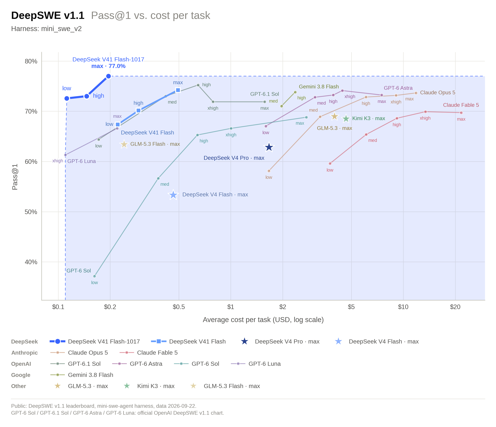
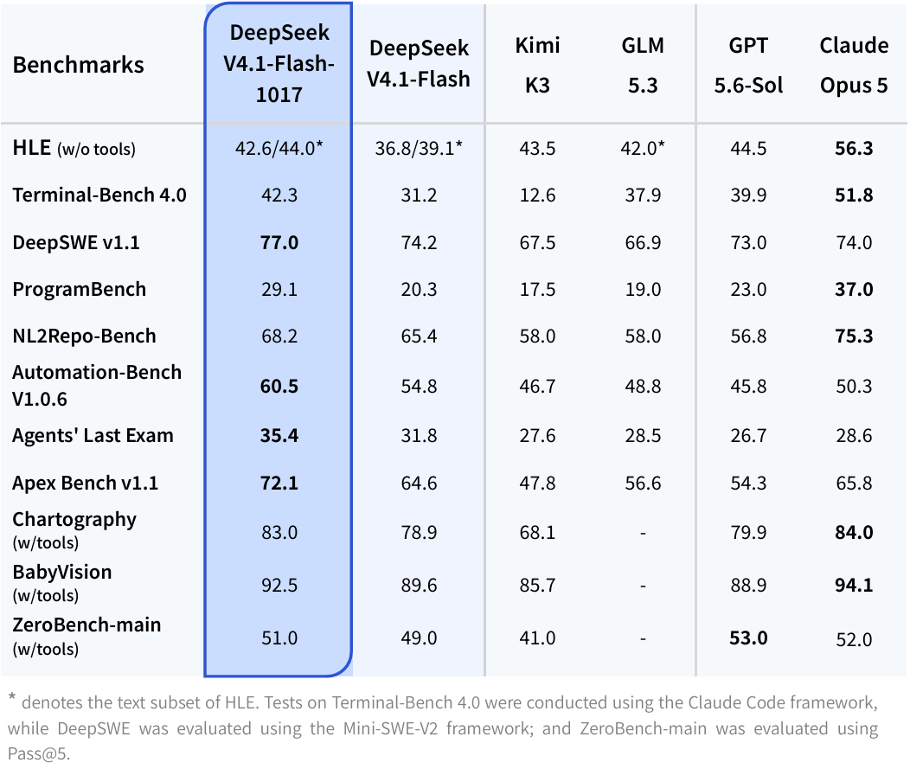
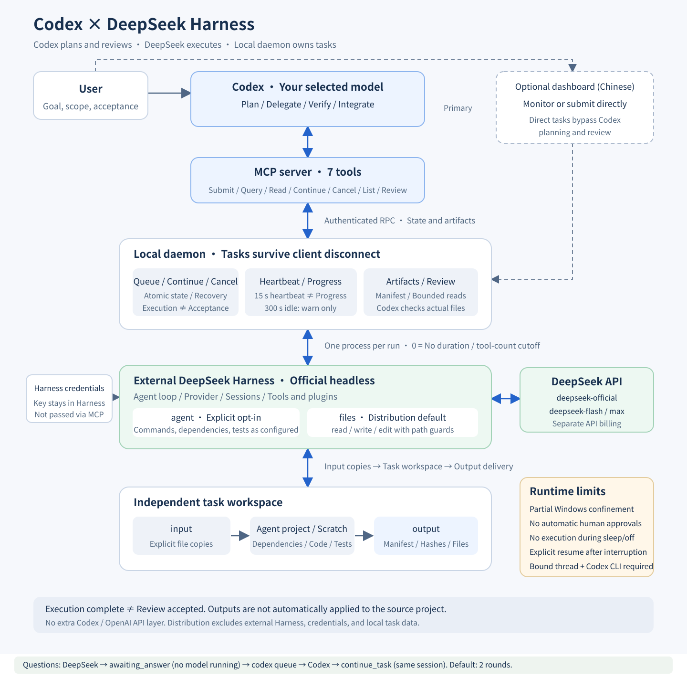

# Codex × DeepSeek Harness

**English** | [简体中文](README.zh-CN.md)

**Keep Codex in charge. Let DeepSeek do the delegated work.** This local MCP bridge lets Codex plan a task, send selected work to the official DeepSeek Harness, inspect the actual files, and independently review the result. Your selected Codex model stays in place; delegated work uses your own DeepSeek API account.

**Now supporting DeepSeek-V4.1-Flash-1017.** In DeepSeek's official **DeepSWE v1.1** performance/cost chart, Flash 1017 reaches **77.0% Pass@1 at max effort**, above the plotted GPT-6 Astra configurations at a lower reported cost per task. See the [official October 17 announcement](https://api-docs.deepseek.com/news/news261017/) for the evaluation and settings.

More official benchmark results

[Official model card and evaluation notes](https://huggingface.co/deepseek-ai/DeepSeek-V4.1-Flash-1017). Original charts by DeepSeek, reproduced unchanged from its official release.

As checked on October 18, 2026, the official API name `deepseek-flash` serves **V4.1-Flash-1017**; the bridge keeps `deepseek-official / deepseek-flash / max`. A Key authenticates your account; the configured model selects what runs. See [official model mapping](https://api-docs.deepseek.com/quick_start/pricing/) and [model configuration](docs/usage.md#model-and-credentials).

## What this project does

You describe work in Codex. When you authorize delegation, Codex submits a bounded task through seven MCP tools. The bridge copies explicitly selected inputs into an independent workspace, starts the official Harness in headless mode, persists progress and outputs, and supports cancellation and follow-up instructions. Codex reads the delivered files, checks them, and decides how to integrate them into your project.

The bridge adds a local queue, supervision, result access, and review records. It reuses the official Harness agent loop, tools, sessions, and credential management. It makes no additional Codex/OpenAI API calls. DeepSeek charges separately for delegated execution.

The included **Chinese-language dashboard is optional**: use it to watch tasks or submit work directly. Direct dashboard submissions need your own review or a later explicit Codex review.

## Before you start

### 1. Install the official DeepSeek Harness locally

Download and build [deepseek-ai/deepseek-harness](https://github.com/deepseek-ai/deepseek-harness) first. This repository does not bundle it. The integration uses a **built source checkout**, not an arbitrary desktop application directory. The current tested baseline is official **`dsh-v0.2.1-rc.2`**, commit [`687f282e8625c6b8d11ff58211a90524be2e4317`](https://github.com/deepseek-ai/deepseek-harness/tree/687f282e8625c6b8d11ff58211a90524be2e4317), a pre-release.

Follow the [manual installation SOP](docs/installation.md) or let your local coding agent follow the [agent installation guide](docs/agent-setup.md). Reuse an existing compatible installation. For an upgrade, follow the [existing installation procedure](docs/installation.md#upgrading-an-existing-harness); see the [October 18 compatibility report](docs/upgrade-20261018.md).

### 2. Provide the installation and data directories

Configure these paths once using `配置本机.cmd` or the setup command in the SOP:

| Setting | Directory to select |
| --- | --- |
| `harnessRoot` | The official Harness source root containing `package.json` and `apps/cli`. |
| `harnessHome` | The actual data directory used when saving your Key: the same `DSH_HOME` as the official UI. |

The SOP uses `<Harness>/.local/dsh-home`. An existing installation may use another location; upstream defaults to `~/.dsh` when `DSH_HOME` is unset. Select the directory without opening its credential file. The saved paths are reused; you do not repeat them for each task. Other projects need access to a loaded MCP configuration—see [using another project](docs/usage.md#using-another-project).

### 3. Create your own API Key and enter it in Harness

Sign in to the [DeepSeek platform](https://platform.deepseek.com/), [create an API Key](https://platform.deepseek.com/api_keys), and [add API credit](https://platform.deepseek.com/top_up) as needed. This project supplies neither Keys nor credit.

Enter the Key yourself in the **official Harness UI**: the first-run **Add API Key** form, or **Settings → Models → DeepSeek (`deepseek-official`) → Edit → API key → Apply**. The bridge uses that same Harness home. Its per-task overlay restores stored authentication in the new headless profile, so there is no second Key field to fill in.

**Do not put your Key in a Codex conversation, this repository's `config.json`, MCP arguments, or GitHub files.** After saving it, the settings webpage need not remain open.

## Choose an installation route

| Route | What you do |
| --- | --- |
| [Manual SOP](docs/installation.md) | Prepare tools, build Harness, enter your Key, configure MCP, and verify step by step. |
| [Let your agent install it](docs/agent-setup.md) | Copy the installation prompt. Your local agent checks existing tools and performs the authorized download, build, setup, and checks; you enter your Key privately. |

Both routes install the same software. The setup script configures an existing installation; it is not an installer containing Node, Harness, and model access.

Once the local client has loaded `codex_ds_harness`, say:

> Delegate this small task to DeepSeek through the Harness MCP. State the inputs and acceptance criteria, read the actual output files, and independently verify the result before integrating it.

Daily use requires **no manual start command and no open dashboard**. A normal ChatGPT webpage does not automatically load a computer's project MCP configuration. New configuration may require a trusted project and a new chat or client reload.

## Architecture

[Architecture and seven-tool API](docs/architecture.md) · [Editable Mermaid](docs/architecture.mmd) · [中文架构](docs/架构与接口.md)

## Modes and lifecycle

| Mode | Scope |
| --- | --- |
| `files` — distribution default | `read`, `write`, and `edit`; reads task `input/output`, writes only `output`. |
| `agent` — explicit opt-in | Native Harness tools for coding, commands, permitted project dependencies, and tests in a task workspace. Available plugins depend on your Harness installation. |

The template has `enableNativeAgent: false`. Enable native coding only with appropriate authorization; `defaultMode` selects the mode when omitted. Both modes deliver through `output`; the bridge never automatically applies files to your original project. Windows native isolation is partial, and headless cannot automatically approve requests requiring human approval.

The client starts MCP; the first valid task operation starts or connects to the local daemon; each executing task gets a separate Harness process. Idle services do not generate model requests. Closing Codex or the dashboard does not cancel submitted work. Use `cancel_task` for one task; stopping the service ends active work and cancels queued tasks.

By default, `maxRuntimeSeconds=0` and `maxToolCalls=0` impose no bridge duration or tool-count cutoff. Completion still ends the task. The template separately caps cumulative protocol output at 4 MiB; `maxStreamBytes: 0` removes that cumulative cap while keeping per-message and deliverable checks. A 15-second heartbeat is separate from progress; 300 seconds without recognized progress produces a warning, not an automatic kill.

Local waiting does not itself generate model tokens. Codex's interpretation and decisions consume its usage; DeepSeek execution is billed separately. The bridge queues event-triggered messages to the originating Codex thread through the installed `codex queue` command; no model polling is needed. This requires a compatible local Codex CLI and a bound thread. Shutdown and sleep prevent continued execution; interrupted tasks require explicit review and continuation.

## Questions and automatic follow-up

DeepSeek can ask a bounded question with evidence, options, and a recommendation. Codex answers through `continue_task`, preserving the original session and permissions. The default task-wide budget is two question rounds.

Bind `submit_task.codexThreadId` to the originating Codex session. With a compatible local `codex queue` command, the daemon pushes questions and completion events to that session; Codex can end its turn while DeepSeek works. Waiting requires no model polling. Each event is attempted once; failed delivery remains visible for manual handling. The resulting Codex decisions still consume the existing account allowance.

See [question and event configuration](docs/usage.md#event-wake-configuration) and [verification](docs/question-verification.md). Unbound dashboard tasks can be answered manually.

## Windows shortcuts

| File | Purpose |
| --- | --- |
| `配置本机.cmd` | First-time path configuration; may install bridge dependencies. Does not download Harness or Node. |
| `检查环境.cmd` | Check local paths and prerequisites; does not validate Key or account balance. |
| `打开任务面板.cmd` | Open the optional dashboard and start the daemon if needed. |
| `停止任务服务.cmd` | Stop this bridge's service, active tasks, and queued work. |

These are setup and maintenance shortcuts. The seven MCP tools do not include global service shutdown; a main agent with local command access can use the maintenance entry point. A later task operation starts the service again. Disable MCP as well if you want to stop using the integration entirely.

## Documentation

- [Manual installation](docs/installation.md) / [中文](docs/安装SOP.md)
- [Agent installation prompt](docs/agent-setup.md) / [中文](docs/交给Agent安装.md)
- [Daily use, model selection, and troubleshooting](docs/usage.md) / [中文](docs/使用说明.md)
- [Architecture and API](docs/architecture.md) / [中文](docs/架构与接口.md)
- [Latest upgrade verification](docs/upgrade-20261018.md) / [中文](docs/上游升级验收-20261018.md)
- [Initial verification record](docs/verification.md) / [中文](docs/验收记录.md)
- [Maintainer instructions](AGENTS.md) / [中文](AGENTS.zh-CN.md)

Source distribution includes the bridge, dashboard, docs, examples, and tests. It excludes external Harness source, runtimes, installed dependencies, credentials, local configuration, and task data. New upstream releases require compatibility checks; they do not automatically replace your local Harness installation.
